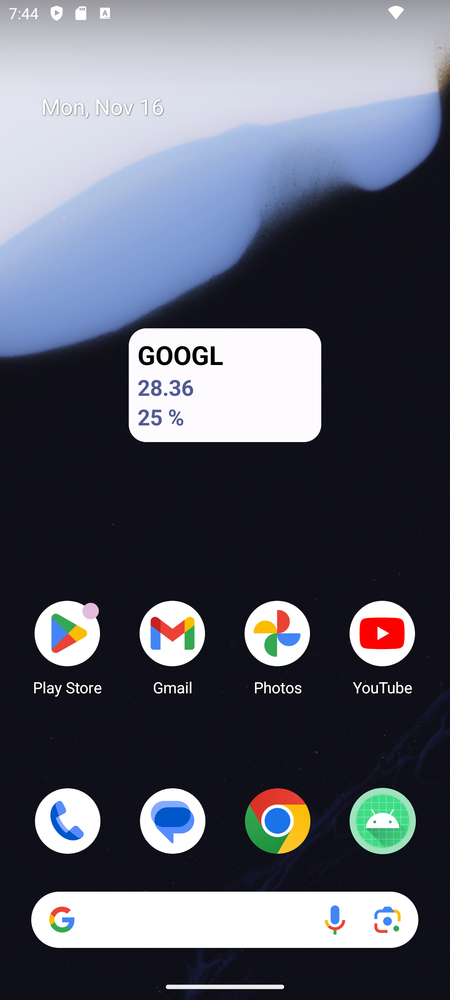
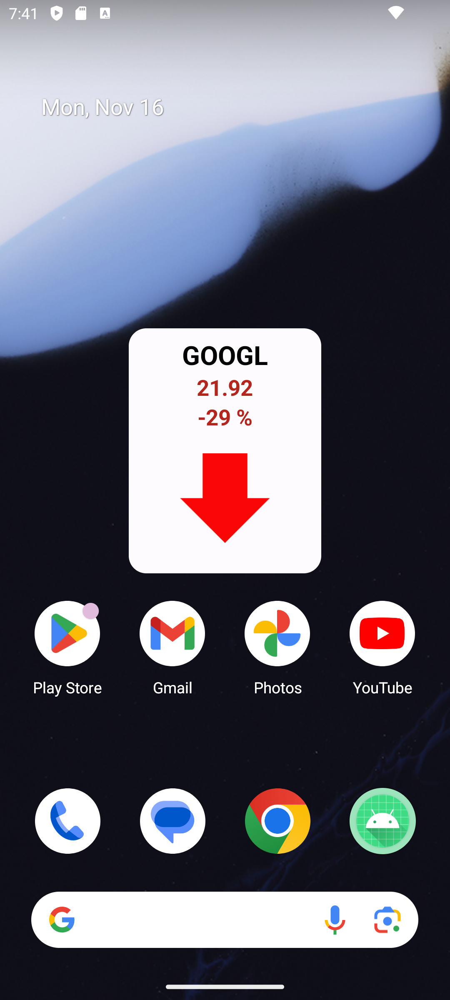
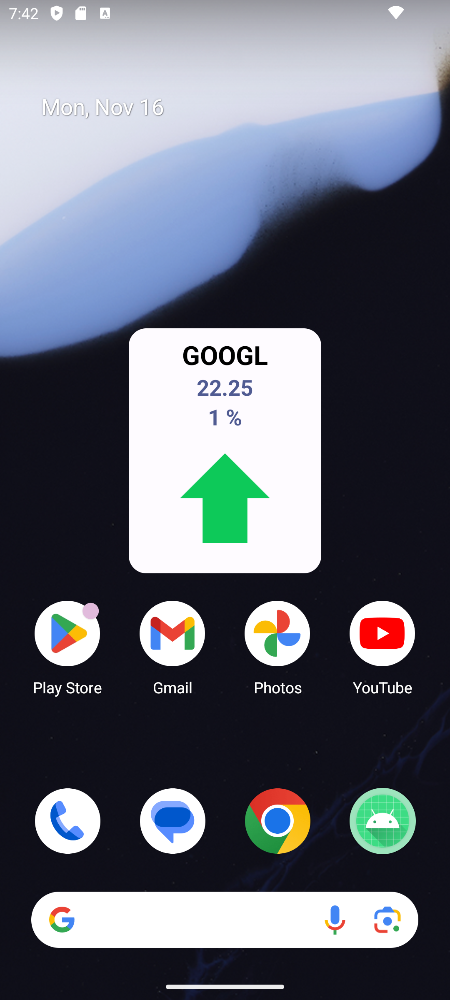

# GlanceExample — лабораторная работа №7

Учебный Android-виджет смоделированных цен GOOGL по «07 ЛР Glance Widget.pdf», разделы 1–14. Биржевой API и интернет для котировок не используются. Публикация на GitHub не выполнялась, remote отсутствует.

## Запуск

Открыть этот каталог в Android Studio. SDK: `C:\Android\Sdk`, minSdk 27, compile/target SDK 37, тестовое устройство **Pixel_API_34 / Android 14**. Используются установленный JBR 25, Gradle Wrapper 9.6.0, AGP 9.4.1, Compose plugin 2.2.10, Compose BOM 2026.02.01, Glance appwidget/material3 **1.1.1**. Версии среды не обновлялись.

В терминале Windows из каталога проекта:

```bat
set "JAVA_HOME=C:\Program Files\Android\Android Studio\jbr"
gradlew.bat :app:assembleDebug
"C:\Android\Sdk\platform-tools\adb.exe" -s emulator-5554 install -r app\build\outputs\apk\debug\app-debug.apk
"C:\Android\Sdk\platform-tools\adb.exe" -s emulator-5554 shell am start -n com.example.glanceexample/.MainActivity
```

После запуска вернуться Home → удержание свободного места → Widgets → GlanceExample → удержание превью и размещение. Начальный размер 2×1 ячейки. Удержание самого виджета открывает маркеры: потянуть нижний вниз для Medium, вверх для Small. Касание любой области обновляет котировку. Основное Activity содержит только краткую инструкцию.

## Архитектура и требования

Все Kotlin-файлы виджета находятся в `app/src/main/java/com/example/glanceexample/glance/`.

| Раздел PDF | Реализация | Этап Git |
|---|---|---|
| 1–2: приложение, зависимости | `app/build.gradle.kts`, `MainActivity.kt` | `95b1382` |
| 3: три оригинальных изображения | `res/drawable/` — побайтово совпадают с материалами | `0c19479` |
| 4–5: singleton и цены | `PriceDataRepo.kt`, тесты процентов/диапазона | `d2a726d`, `9c57034` |
| 6–7: Glance и receiver | `StockAppWidget.kt`, `StockAppWidgetReceiver.kt` | `6c3410f` |
| 8–10: XML, manifest, размещение | `res/xml/stock_app_widget_info.xml`, manifest | `e3d4ec5` |
| 11: цикл ~20 секунд | `PriceUpdater.kt` | `43f84ce` |
| 12: GOOGL, цена, процент, цвет | `StockDisplay`, `Small` | `43f84ce`, `4df1972` |
| 13: адаптивность, стрелки | `Medium`, `SizeMode.Responsive` | `4df1972` |
| 14: касание | `RefreshAction.kt`, clickable в обоих макетах | `24494df` |

`currentPrice` имеет требуемый тип `StateFlow<Float>`. Дополнительный StateFlow `quote` несёт единый снимок цены, предыдущей цены и номера обновления; Glance подписывается на него, чтобы показывать согласованные значения. Цены генерируются выражением `Random.nextInt(20, 35) + Random.nextFloat()`.

Процент: `(newPrice - previousPrice) / previousPrice * 100`, целая часть как в лекции. Для первого обновления previous=0 и процент=0 без деления на ноль. Изначально доступна нейтральная цена 25.00. При росте используется primary темы и оригинальная зелёная стрелка, при падении — error и красная. Первое/равное значение нейтрально, без стрелки. Небольшое ненулевое изменение может округлиться до 0%; направление при этом определяется фактическими ценами.

Small: 100×80 dp, три строки, 8 dp поля, шрифты 24/20 sp. Medium: 120×120 dp, центрирование, радиус 15 dp, стрелка с полями 20 dp. Это размеры выбора responsive-макета, а фактический размер на launcher определяется ячейками. Неизвестный малый размер получает Small, а не пустой виджет.

## Необходимые адаптации лекции

- Вместо нового бесконечного job в каждом экземпляре виджета — один синхронизированно запускаемый процессный `PriceUpdater`. Он останавливается при удалении последнего виджета; каждый рендер не создаёт новый цикл.
- `RefreshAction : ActionCallback` обновляет данные и вызывает `updateAll`, вместо неподтверждённой перерисовки от старой lambda.
- Защита первого процента от деления на ноль, нейтральное первое значение, атомарный снимок данных.
- Зависимости заданы непосредственно в Gradle, без необязательного version catalog. Исходные ресурсы и loading layout Glance сохранены.

**Ограничение:** интервал около 20 секунд проверен только во время активной тестовой сессии с живым процессом. `delay(20_000)` выполняется после предыдущего обновления. Android может заморозить/убить процесс; устойчивое фоновое обновление каждые 20 секунд не гарантируется. `updatePeriodMillis=0`, Foreground Service, wakelock и WorkManager не добавлялись. Состояние хранится в памяти, восстановление котировок после смерти процесса не заявляется.

## Проверки

Сборка и lint успешны; lint: **0 ошибок, 11 предупреждений** (перечень в summary.json). JVM: три теста репозитория и один размеров успешно выполнены по этапам. На настоящем launcher Pixel_API_34 проверены размещение, оба макета, расширение и сжатие, нажатия, два последовательных автоматических обновления, оба направления стрелок. Это **не** утверждение о наличии AndroidJUnitRunner-тестов: UI проверялся ADB input, XML дерева, скриншотами и Logcat.

[Подробная приёмка](docs/VERIFICATION.md), [сводка и хеши](docs/evidence/summary.json).





## Кратко для защиты

1. **Что такое Glance?** Декларативное описание AppWidget, преобразуемое в RemoteViews; это не обычный Compose UI внутри launcher.
2. **Зачем receiver?** Получает события AppWidget и связывает их с GlanceAppWidget.
3. **Зачем StateFlow?** Хранит текущее значение и уведомляет подписчиков об изменении.
4. **Почему одного StateFlow мало?** Состояние приложения и отображение launcher различаются; callback/таймер дополнительно вызывают updateAll.
5. **Как выбирается размер?** SizeMode.Responsive объявляет допустимые размеры, LocalSize определяет выбранный вариант.
6. **Почему 20 секунд не гарантированы всегда?** Корутина живёт в процессе приложения и не является системным планировщиком.
7. **Почему первый процент нулевой?** Предыдущей рыночной точки ещё нет; деление на ноль запрещено.
